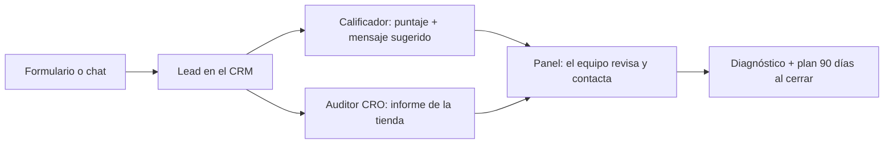

# Escalá Growth Studio: agencia operada con agentes de IA

Sitio web, panel interno y 6 agentes de IA (Claude) que hacen el trabajo operativo de la
agencia: atienden a los interesados, califican leads, auditan tiendas, arman calendarios de
contenido, escriben anuncios, redactan reportes y preparan el plan de 90 días de cada cliente.

## Qué hace cada agente

| Agente | Dónde se activa | Qué entrega |
|---|---|---|
| **Asesor comercial** (chat) | Chat del sitio | Responde dudas, recomienda un plan, guarda el lead en el CRM y pide la auditoría de la tienda |
| **Calificador de leads** | Automático con cada formulario | Puntaje 0–100, temperatura, plan recomendado y primer mensaje de WhatsApp listo para copiar |
| **Auditor CRO** | Automático si el lead deja el link de su tienda, o desde el panel | Lee la tienda en vivo (lectura y búsqueda web), evalúa 20 puntos y prioriza las 10 mejoras |
| **Contenido mensual** | Panel | Estrategia, pilares y calendario con guiones de reels, carruseles e historias |
| **Creativos de pauta** | Panel | Tanda de anuncios para Meta/TikTok con ángulos distintos y plan de testeo |
| **Reporte semanal** | Panel (pegás las métricas) | Reporte para el cliente: dato → señal → hipótesis → acción |
| **Diagnóstico + plan 90 días** | Panel o desde un lead | Corre auditoría y calendario en paralelo y arma el plan de 90 días con backlog ICE |

Flujo automático de un lead que llega por el sitio:



## Cómo ponerlo en marcha

Requisitos: Node.js 22 o superior.

```bash
cd agencia
npm install
```

**Probar sin costo (modo demo, respuestas simuladas):**

```bash
npm run demo
```

Abrí http://localhost:3000 (sitio) y http://localhost:3000/panel (panel, token `demo`).

**Con los agentes reales:**

1. Creá una API key en https://console.anthropic.com.
2. Copiá `.env.example` a `.env` y completá `ANTHROPIC_API_KEY` y `ADMIN_TOKEN`.
3. `npm start`

## Estructura

```
agencia/
├── server.js              API, sitio y panel
├── sitio/index.html       Sitio público con calculadora, formulario y chat
├── panel/index.html       Panel interno: leads, trabajos, lanzar agentes, conversaciones
├── src/
│   ├── ai.js              Acceso único a Claude (modelo, fallbacks, errores)
│   ├── jobs.js            Cola de trabajos en segundo plano con reintentos
│   ├── store.js           Base de datos en archivo JSON (data/db.json)
│   ├── mock.js            Respuestas simuladas para el modo demo
│   └── agents/            Un archivo por agente + conocimiento.js (precios, tono, checklist)
├── test/                  Pruebas de punta a punta y de la integración con la API
└── PLAN_DE_NEGOCIO.md
```

Para cambiar precios, servicios, tono o el checklist de auditoría, editá
`src/agents/conocimiento.js`: todos los agentes lo leen.

## Detalles técnicos

- Modelo: `claude-opus-5-5` para todos los agentes (se cambia con `ESCALA_MODEL`).
  El esfuerzo de razonamiento se ajusta por agente: bajo en el chat y la calificación (rápido y barato),
  alto en la auditoría y el plan de 90 días.
- Si un clasificador de seguridad rechaza un pedido, la API lo reintenta sola con el modelo de
  respaldo recomendado (`fallbacks: "default"`).
- Los resultados estructurados (auditoría, calendario, anuncios, calificación) se validan con esquemas Zod.
- El Auditor usa las herramientas de lectura y búsqueda web de Anthropic, que corren en sus servidores.
  El contenido de las páginas se trata como datos, nunca como instrucciones.
- Seguridad: el panel exige `ADMIN_TOKEN`; el formulario y el chat tienen límite de pedidos por IP;
  los textos de entrada se recortan; el markdown del panel se sanitiza.
- Webhook opcional (`WEBHOOK_URL`) para mandar cada lead y cada trabajo terminado a Make, Zapier o n8n
  (por ejemplo, para avisar por WhatsApp o cargarlo en un CRM).

## Pruebas

```bash
npm test
```

Cubren el flujo completo en modo demo (formulario, chat, calificación, auditoría, los 6 agentes desde
el panel, errores y reintentos) y verifican contra un servidor falso que los pedidos a la API de
Anthropic salen bien armados (modelo, fallbacks, salida estructurada, herramientas, rechazos, API key inválida).

## Costos de referencia

Cada trabajo consume tokens de la API (Claude Opus 5.5: 4 USD por millón de tokens de entrada y
20 USD por millón de salida). Una conversación de chat o una calificación cuesta centavos; una auditoría
con lectura web o un calendario mensual completo, del orden de decenas de centavos a un dólar. Mirá el
consumo real en console.anthropic.com y limitá la concurrencia con `MAX_JOBS`.

## Para producción

- Desplegarlo en un servicio con disco persistente (Railway, Render, Fly.io o un VPS) para `data/db.json`,
  o reemplazar `src/store.js` por Postgres cuando crezca el volumen.
- Servirlo detrás de HTTPS y con un `ADMIN_TOKEN` largo.
- Si va detrás de un proxy, activar `app.set("trust proxy", 1)` para que el límite por IP funcione bien.
