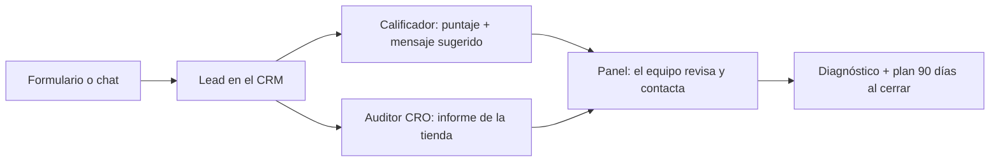

# Escalá Growth Studio: agencia operada con agentes de IA

Sitio web, panel interno y agentes de IA (Claude) que hacen el trabajo operativo de la agencia:
atienden a los interesados, califican leads, hacen seguimiento, auditan tiendas, arman calendarios de
contenido, escriben anuncios, redactan reportes y preparan el plan de 90 días de cada cliente.

Funcionan solos: cada entrega pasa por control de calidad y se autocorrige; una agenda lanza el trabajo
recurrente; los errores transitorios se reintentan; el gasto tiene un límite diario. Las personas
intervienen solo cuando el sistema lo pide. La investigación detrás del diseño está en
[`docs/INVESTIGACION_AGENTES.md`](docs/INVESTIGACION_AGENTES.md).

**¿Arrancás con un solo cliente?** Seguí [`docs/ARRANQUE_UN_CLIENTE.md`](docs/ARRANQUE_UN_CLIENTE.md): configuración mínima,
puesta en marcha en una semana, horas por plan y cómo convertirlo en el caso que traiga a los siguientes.

## Qué hace cada agente

| Agente | Dónde se activa | Qué entrega |
|---|---|---|
| **Asesor comercial** (chat) | Chat del sitio | Responde dudas, recomienda un plan, guarda el lead en el CRM y pide la auditoría de la tienda |
| **Calificador de leads** | Automático con cada formulario | Puntaje 0–100, temperatura, plan recomendado y primer mensaje de WhatsApp listo para copiar |
| **Auditor CRO** | Automático si el lead deja el link de su tienda, o desde el panel | Lee la tienda en vivo (lectura y búsqueda web), evalúa 20 puntos y prioriza las 10 mejoras |
| **Contenido mensual** | Panel | Estrategia, pilares y calendario con guiones de reels, carruseles e historias |
| **Creativos de pauta** | Panel | Tanda de anuncios para Meta/TikTok con ángulos distintos y plan de testeo |
| **Reporte semanal** | Panel (pegás las métricas) | Reporte para el cliente: dato → señal → hipótesis → acción |
| **Diagnóstico + plan 90 días** | Automático al marcar un lead como cliente, o desde el panel | Corre auditoría y calendario en paralelo y arma el plan de 90 días con backlog ICE |
| **Seguimiento** | Agenda: leads sin movimiento hace 3 días | Mensaje de seguimiento que aporta algo concreto (máximo 2 por lead) |
| **Revisor de calidad** | Después de cada entrega | Chequeos de código + rúbrica por criterio; si no aprueba, devuelve correcciones y el agente rehace |

Flujo automático de un lead que llega por el sitio:



## Operación autónoma

| Qué | Cómo funciona |
|---|---|
| Control de calidad | Chequeos objetivos (cantidades, evidencia, números que no están en los datos) + rúbrica con criterios críticos. Aprueba el código, no el modelo. Hasta 2 rondas de autocorrección; si no alcanza, va a **Requieren atención**. |
| Memoria por cliente | Brief + lecciones que salen del feedback del equipo. Cada agente las recibe en cada pedido. |
| Agenda | Desde el día 25: calendario y anuncios del mes siguiente. Primera semana: re-auditoría. Todos los días: seguimiento de leads quietos. Nunca duplica. |
| Puesta en marcha | Al marcar un lead como cliente se crea su ficha y corre el diagnóstico con el plan de 90 días. |
| Ingesta de métricas | `POST /api/ingesta/metricas` (header `x-ingesta-token`) con `{clienteId, periodo, metricas}`. Lo usa Make, Zapier o n8n para generar el reporte semanal solo. |
| Reintentos | Errores de red o de límite de la API: espera exponencial, hasta 4 intentos, aun tras reiniciar. |
| Presupuesto | `PRESUPUESTO_DIARIO_USD`: al llegar al límite la cola se pausa y se retoma al día siguiente. |
| Avisos | Webhook con eventos `lead_nuevo`, `entregable_listo`, `entregable_aprobado` y `requiere_atencion`. |
| Calibración | El panel muestra cuánto coincide el revisor automático con las decisiones del equipo. |

## Preparado para 20 clientes

| Qué | Cómo funciona |
|---|---|
| Cartera | Vista principal del panel: semáforo por cliente, cumplimiento de los entregables de su plan, trabajos trabados, costo de IA y margen del mes |
| Cola justa | Prioridades (los leads primero, después las entregas y por último el mantenimiento) y como máximo un trabajo a la vez por cliente: ninguno acapara la cola |
| Agenda escalonada | Cada cliente tiene su propio día de planificación (del 20 al 25) y de re-auditoría (del 1 al 10), así no se acumula todo el mismo día |
| Portal del cliente | Link privado por cliente (`/portal/...`) con sus entregas y un espacio para comentar. Por cliente se elige si ve solo lo aprobado por el equipo o también lo aprobado por el control de calidad. Los comentarios llegan a **Requieren atención** |
| Responsables | Cada cliente tiene un account manager; los avisos del webhook lo incluyen |
| Métricas faltantes | Si un plan con reporte semanal no recibe métricas en 8 días, se avisa |
| Base de datos | SQLite (incluido en Node, sin instalar nada), con índices y migración automática desde la versión anterior |
| Copias de seguridad | Una por día en `data/backups`, se guardan las últimas 14 |
| Monitoreo | `GET /api/salud` para un servicio externo de uptime |
| Simulación | `npm run simular` corre un mes con 20 clientes en modo demo y proyecta carga, tiempos y costos (`docs/SIMULACION_20_CLIENTES.md`) |

Rutina sugerida: 15 minutos por día en la pestaña **Requieren atención**, y feedback sobre algunas entregas
aprobadas para que la memoria y la calibración mejoren.

## Cómo ponerlo en marcha

Requisitos: Node.js 22 o superior.

```bash
cd agencia
npm install
```

**Probar sin costo (modo demo, respuestas simuladas):**

```bash
npm run demo
```

Abrí http://localhost:3000 (sitio) y http://localhost:3000/panel (panel, token `demo`).

**Con los agentes reales:**

1. Creá una API key en https://console.anthropic.com.
2. Copiá `.env.example` a `.env` y completá `ANTHROPIC_API_KEY` y `ADMIN_TOKEN`.
3. `npm start`

## Estructura

```
agencia/
├── server.js              API, sitio y panel
├── sitio/index.html       Sitio público con calculadora, formulario y chat
├── panel/index.html       Panel interno: cartera, leads, atención, trabajos, clientes, conversaciones
├── portal/index.html      Portal privado de cada cliente
├── scripts/simular-mes.js Simulación de un mes con 20 clientes
├── docs/                  Investigación y decisiones de diseño
├── evals/                 Banco de evaluaciones (casos + runner)
├── src/
│   ├── ai.js              Acceso único a Claude (modelo, fallbacks, caché, telemetría)
│   ├── jobs.js            Cola: calidad, autocorrección, reintentos, presupuesto, feedback
│   ├── calidad.js         Revisor: chequeos de código + rúbrica
│   ├── memoria.js         Clientes: brief y lecciones
│   ├── agenda.js          Trabajo recurrente y seguimientos
│   ├── telemetria.js      Costos por llamada, trabajo y día
│   ├── store.js           Base de datos SQLite (data/escala.db) con migración desde JSON
│   ├── cartera.js         Cumplimiento por plan, salud, costo y margen por cliente
│   ├── mock.js            Respuestas simuladas para el modo demo
│   └── agents/            Un archivo por agente + conocimiento.js (precios, tono, checklist)
├── test/                  Pruebas de punta a punta y de la integración con la API
└── PLAN_DE_NEGOCIO.md
```

Para cambiar precios, servicios, tono o el checklist de auditoría, editá
`src/agents/conocimiento.js`: todos los agentes lo leen.

## Detalles técnicos

- Modelo: `claude-opus-5-5` para todos los agentes (se cambia con `ESCALA_MODEL`).
  El esfuerzo de razonamiento se ajusta por agente: bajo en el chat y la calificación (rápido y barato),
  alto en la auditoría y el plan de 90 días.
- Si un clasificador de seguridad rechaza un pedido, la API lo reintenta sola con el modelo de
  respaldo recomendado (`fallbacks: "default"`).
- Los resultados estructurados (auditoría, calendario, anuncios, calificación) se validan con esquemas Zod.
- El Auditor usa las herramientas de lectura y búsqueda web de Anthropic, que corren en sus servidores.
  El contenido de las páginas se trata como datos, nunca como instrucciones.
- Seguridad: el panel exige `ADMIN_TOKEN`; el formulario y el chat tienen límite de pedidos por IP;
  los textos de entrada se recortan; el markdown del panel se sanitiza.
- Webhook opcional (`WEBHOOK_URL`) para mandar cada lead y cada trabajo terminado a Make, Zapier o n8n
  (por ejemplo, para avisar por WhatsApp o cargarlo en un CRM).

## Pruebas y evaluaciones

```bash
npm test                    # 38 pruebas, sin costo
npm run simular             # un mes con 20 clientes en modo demo
npm run eval -- --reps 3    # banco de evaluaciones con la API real
```

- **Pruebas:** flujo completo en modo demo (formulario, chat, agentes, control de calidad con
  autocorrección, feedback y memoria, puesta en marcha de clientes, ingesta, agenda, presupuesto,
  reintentos, derivación) y verificación contra un servidor falso de que los pedidos a la API salen bien
  armados (fallbacks, caché, estado del CRM, salida estructurada, costos).
- **Evaluaciones** (`evals/`): 13 casos reales en ambas direcciones (registrar y no registrar un lead,
  resistir una inyección, no inventar descuentos, no auditar un sitio inexistente, no inventar números,
  respetar políticas publicitarias). Reportan aciertos y pass^k, separan errores de ejecución de errores
  del modelo y guardan las transcripciones. Corré las evaluaciones después de cada cambio de prompt y sumá
  como caso cada error real que aparezca.

## Costos de referencia

Cada trabajo consume tokens de la API (Claude Opus 5.5: 4 USD por millón de tokens de entrada y
20 USD por millón de salida). Una conversación de chat o una calificación cuesta centavos; una auditoría
con lectura web o un calendario mensual completo, del orden de decenas de centavos a un dólar. Mirá el
consumo real en el panel (costo por trabajo y gasto del día) y en console.anthropic.com.
El control de calidad agrega una llamada por entrega (y una más por cada ronda de corrección); el caché
de prompts compensa parte de ese costo. Poné un `PRESUPUESTO_DIARIO_USD` desde el primer día.

## Para producción

- Desplegarlo en un servicio con disco persistente (Railway, Render, Fly.io o un VPS) para `data/`.
  SQLite alcanza con holgura para 20 a 50 clientes; más allá, migrar `src/store.js` a Postgres
  (la interfaz está aislada en ese archivo).
- Copiar `data/backups` fuera del servidor (por ejemplo, a un bucket) una vez por semana.
- Servirlo detrás de HTTPS y con un `ADMIN_TOKEN` largo.
- Si va detrás de un proxy, poner `TRUST_PROXY=1` para que el límite por IP funcione bien.
