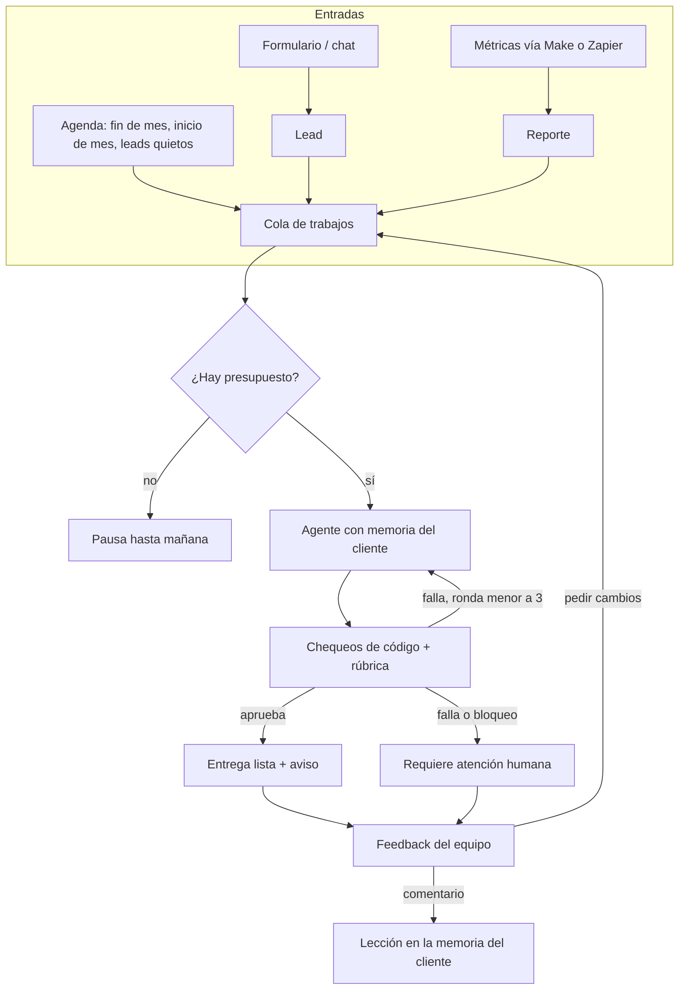

# Agentes que trabajan solos: investigación y decisiones de diseño

Este documento resume qué dice el mejor conocimiento público sobre cómo construir agentes de IA
confiables, dónde ese conocimiento se queda corto para una operación real como la de Escalá, y qué
hicimos al respecto en el código. La idea es pararse sobre hombros de gigantes y reforzar los puntos
donde los gigantes no llegan.

## 1. Fuentes

| Fuente | Qué aporta |
|---|---|
| Anthropic, *Building effective agents* (dic. 2024) | Patrones de flujo (encadenar, enrutar, paralelizar, orquestador-trabajadores, evaluador-optimizador). Cuándo usar un agente y cuándo un flujo fijo. |
| Anthropic, *Writing effective tools for agents* (sep. 2025) | Diseño de herramientas: pocas y sin superposición, descripciones como para alguien nuevo, errores que indiquen cómo corregir, respuestas cortas. |
| Anthropic, *Effective context engineering for AI agents* (sep. 2025) | El contexto es un recurso finito: el menor conjunto de información de alto valor. Notas persistentes y memoria fuera de la ventana. |
| Anthropic, *Demystifying evals for AI agents* (ene. 2026) | Calificadores de código, de modelo y humanos. pass^k. Leer transcripciones. Casos en ambas direcciones. Empezar con 20 a 50 casos tomados de errores reales. |
| Anthropic, *Effective harnesses for long-running agents* (nov. 2025) | Progreso incremental, estado recuperable, verificar de punta a punta antes de dar algo por terminado. |
| HumanLayer, *12-factor agents* | Ser dueño del prompt, del contexto y del flujo de control. Agentes chicos y enfocados. Pausar y retomar. Contactar humanos con una herramienta. |
| Guía de la API de Claude (incluida en Claude Code) | Caché de prompts, mensajes de sistema a mitad de conversación, salidas estructuradas, respaldo automático ante rechazos, chequeo de salud de evaluaciones. |

No pudimos leer el paper *Why Do Multi-Agent LLM Systems Fail?* (MAST) porque arxiv.org está bloqueado en
este entorno. No lo citamos de memoria.

## 2. Lo que dice el conocimiento disponible, en ocho principios

1. **Simple primero.** La mayoría de las tareas se resuelven mejor con flujos fijos que con un agente que
   decide todo. Solo se agrega complejidad cuando mejora resultados que se pueden medir.
2. **Agentes chicos y enfocados.** Cada agente hace una cosa bien en pocos pasos. Con contextos largos el
   modelo se pierde.
3. **Ser dueño del contexto.** Al modelo se le da exactamente lo que necesita: el conocimiento estable
   primero (y en caché) y lo variable al final.
4. **Herramientas como interfaz de producto.** Pocas herramientas, nombres claros, validación estricta y
   errores que digan cómo seguir.
5. **Verificar antes de declarar terminado.** El modelo tiende a dar por hecho lo que no comprobó. La
   verificación tiene que ser externa y, siempre que se pueda, objetiva.
6. **Estado durable.** Todo trabajo se puede pausar, retomar y reintentar sin perder ni duplicar nada.
7. **Humanos como herramienta.** El agente pide ayuda en forma explícita cuando corresponde, y el sistema
   escala por excepción.
8. **Evaluar como un producto.** Casos reales, calificadores combinados, varias repeticiones y lectura de
   transcripciones. Lo que no se mide se degrada en silencio.

## 3. Dónde el conocimiento se queda corto y cómo lo reforzamos

| Punto débil del conocimiento común | Riesgo en una agencia real | Refuerzo implementado |
|---|---|---|
| El patrón evaluador-optimizador deja que un modelo juzgue a otro, y el juez puede ser complaciente o inconsistente | Entregas mediocres aprobadas o loops infinitos de corrección | **Decisión híbrida** (`src/calidad.js`): primero chequeos de código objetivos (cantidades, evidencia, números que no aparecen en los datos), después una rúbrica criterio por criterio con salida "no evaluable", y **la aprobación la decide el código**: cero problemas objetivos, ningún criterio crítico incumplido y puntaje ≥ umbral. Máximo 2 rondas de corrección y después escala. |
| Se recomienda calibrar al juez contra humanos, pero no se dice cómo hacerlo en producción | No saber si el control automático merece confianza | **Calibración continua**: cada decisión del equipo (aprobar o pedir cambios) se compara con lo que decidió el revisor. El panel muestra el porcentaje de acuerdo. Si baja, se ajusta la rúbrica o el umbral. |
| Los LLM inventan números con soltura y un juez LLM no siempre lo detecta | Un reporte al cliente con cifras falsas destruye la confianza | **Verificación determinística**: todo número de la tabla del reporte tiene que existir en las métricas recibidas. Si no existe, el reporte no se entrega. |
| "Usá memoria" es un consejo genérico: no dice qué recordar ni cómo evitar que se contamine | Errores repetidos mes a mes, o una memoria llena de ruido | **Memoria por cliente basada en feedback humano** (`src/memoria.js`): brief más lecciones que salen de los comentarios del equipo, nunca de lo que el modelo dice de sí mismo. Se guardan hasta 40 y entran al contexto las 15 más recientes. |
| Los agentes de chat pierden lo que hicieron en turnos anteriores cuando el historial guarda solo el texto | Registrar dos veces el mismo lead o prometer una auditoría ya pedida | **Estado del CRM como mensaje de sistema** al final de cada turno: el agente sabe qué ya hizo, sin romper el caché del historial. |
| La autonomía se plantea como "el agente decide más", y eso aumenta el riesgo | Acciones irreversibles sin control | **Autonomía por agenda y por excepción**: los agentes no envían nada al cliente por su cuenta. Generan, se autocorrigen y dejan la entrega lista. El webhook avisa "entregable_listo" o "requiere_atencion", y el negocio decide qué se envía solo. |
| Los costos casi nunca aparecen en los marcos de diseño | Una factura sorpresa o un loop costoso | **Telemetría y presupuesto**: costo por llamada, por trabajo y por día, con un límite diario que pausa la cola y la retoma al día siguiente. El caché de prompts abarata lo que se repite. |
| La robustez se trata como "manejar errores" | Trabajos perdidos por un corte de red o un reinicio | **Reintentos durables**: espera exponencial con variación aleatoria que sobrevive reinicios, recuperación de trabajos a medias al arrancar y claves únicas en la agenda para no duplicar. |
| La inyección de instrucciones se trata solo en el chat | Una página web o un dato de un lead que intente manipular al agente | Todo dato externo va entre etiquetas y con la instrucción explícita de tratarlo como material, no como orden. El chat tiene un caso de evaluación específico de inyección. |

## 4. Mapa de la operación autónoma

## 5. Debilidades de la versión 1 y cómo se corrigieron

| # | Debilidad encontrada | Corrección |
|---|---|---|
| 1 | Ninguna entrega se verificaba: todo dependía de que alguien revisara | Control de calidad automático con autocorrección y escalamiento |
| 2 | Los agentes no recordaban nada del cliente | Clientes con brief y lecciones, inyectados en cada pedido |
| 3 | Nada pasaba si nadie lanzaba los trabajos | Agenda: calendarios y anuncios del mes siguiente, re-auditorías y seguimiento de leads |
| 4 | Un error de red mataba el trabajo | Reintentos con espera exponencial que sobreviven reinicios |
| 5 | No había visibilidad de costos | Costo por trabajo y por día, presupuesto diario con pausa automática |
| 6 | El chat olvidaba qué había hecho y no podía derivar a una persona | Estado del CRM por turno, herramienta `derivar_a_humano` y validación del contacto |
| 7 | La auditoría podía afirmar cosas sin haberlas visto | Evidencia obligatoria por punto, salida explícita "sitio no accesible" y verificación por código |
| 8 | No había forma de saber si un cambio de prompt mejoraba o empeoraba | Banco de evaluaciones con casos en ambas direcciones, pass^k y transcripciones |
| 9 | Pasar de lead a cliente era manual | Al marcar un lead como cliente se crea su ficha y arranca el diagnóstico |
| 10 | Los reportes requerían pegar métricas a mano | Endpoint de ingesta para que Make, Zapier o n8n envíen las métricas y el reporte salga solo |

## 6. Lo que todavía no está resuelto

- **No se probó contra la API real.** Este entorno no tiene API key. Todo está verificado en modo demo y
  contra un servidor que simula la API. El primer paso al activarlo es correr `npm run eval -- --reps 3`
  con la key y leer las transcripciones.
- **El revisor usa el mismo modelo que el generador.** Mitigamos con chequeos de código y con la métrica
  de acuerdo con el equipo. Si el acuerdo baja del 85%, conviene endurecer la rúbrica o sumar un segundo
  revisor con otra configuración.
- **Algunas tiendas bloquean la lectura automática.** En ese caso la auditoría no inventa nada: escala.
- **El envío al cliente (WhatsApp o email) se hace por webhook.** Hay que conectarlo en Make o n8n y
  decidir qué entregas salen solas y cuáles con aprobación.
- **La base de datos es un archivo JSON.** Alcanza para decenas de clientes. Con cientos, migrar
  `src/store.js` a Postgres.
- **Las lecciones solo se suman.** Si dos lecciones se contradicen, gana la más reciente por su posición,
  pero conviene revisarlas cada tanto desde el panel.

## 7. Rutina de supervisión (15 minutos por día)

1. Abrir **Requieren atención**: resolver lo que el sistema no pudo resolver solo.
2. Mirar el **gasto del día** y el **acuerdo del revisor con el equipo**.
3. Dar feedback sobre 2 o 3 entregas al azar, aunque estén aprobadas: eso alimenta la memoria y calibra
   al revisor.
4. Una vez por semana: correr las evaluaciones y sumar como caso nuevo cada error real de la semana.
